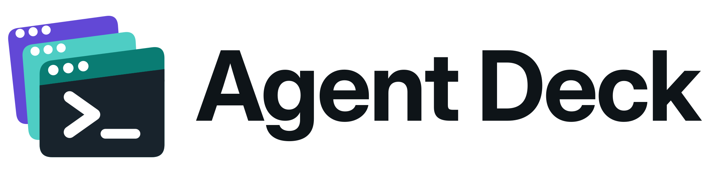
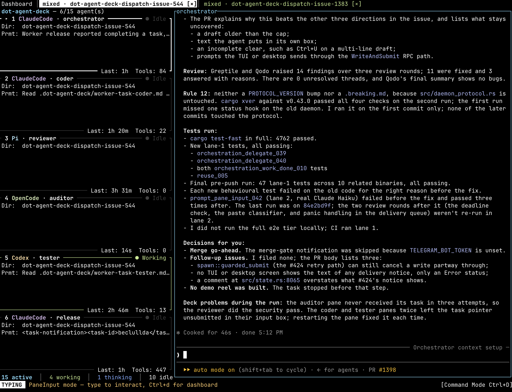
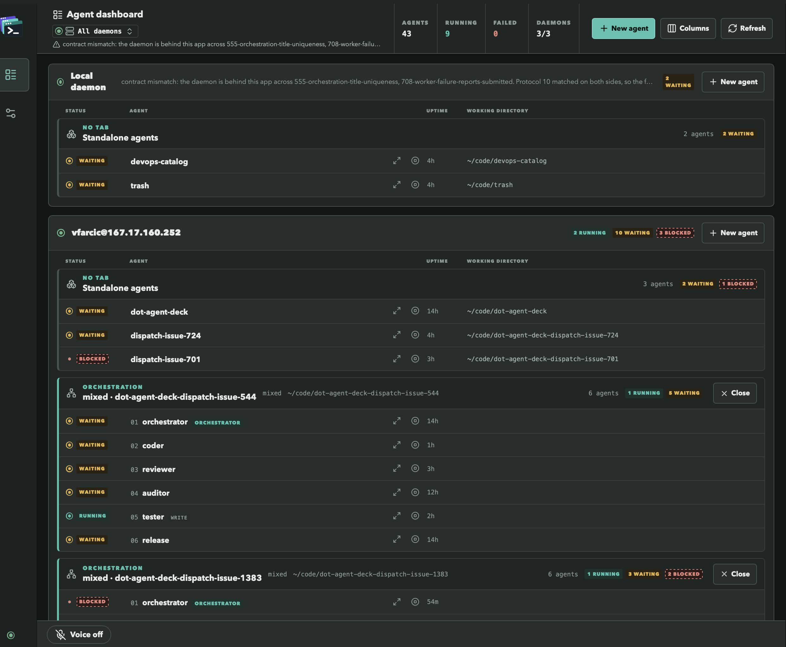

<p align="center">
  <picture>
    <source media="(prefers-color-scheme: dark)" srcset="assets/brand/lockup-dark.svg">
    
  </picture>
</p>

# dot-agent-deck

**Stop watching one agent. Run the whole team.**

Agent Deck runs your AI coding agents under one background daemon, shows what each of them is doing in real time — in a terminal UI or in a desktop app, both watching the same agents — and starts new work for you: a team under one orchestrator, an isolated unit in its own copy of the repo, or a task that fires on a schedule.

[](https://github.com/vfarcic/dot-agent-deck/actions/workflows/ci.yml)
[](https://github.com/vfarcic/dot-agent-deck/releases/latest)
[](LICENSE)

<p align="center">
  
  
</p>
<p align="center"><em>The same six-role orchestration in the terminal UI (left) and the desktop app (right).</em></p>

## What it does

- **Two clients, one daemon.** The agents run under a background daemon, not inside a window. An agent you start in the terminal UI shows up in the desktop app and the other way round, and detaching the terminal UI or quitting the desktop app leaves the agents running. The desktop app (alpha, macOS on Apple Silicon and Linux amd64) also puts several daemons on one dashboard and takes voice commands. [Getting started](docs/getting-started.md), [Desktop app](docs/desktop/index.md)
- **The agent client you already use.** Claude Code, Codex, OpenCode, Pi and Devin run as they are, with your own configs and skills, and both clients show whether each agent is thinking, working, waiting for you or idle; how finely depends on what the agent reports. Other commands run in a pane too, without status tracking. [Session management](docs/session-management.md)
- **Orchestration.** Define the roles your project needs in `.dot-agent-deck.toml` and start them together, from either client. One orchestrator hands each piece of work to the right worker, you watch the hand-offs land, and the deck tells the orchestrator when a worker goes quiet. [Orchestration](docs/orchestration.md), [Idle workers](docs/idle-workers-and-notifications.md)
- **Dispatch.** Ask a dispatcher agent for something and it makes a separate copy of your repository (a git worktree), puts one agent or a whole orchestration to work in it, and reports back when the unit is done. Your own working tree is not touched. [Dispatcher mode](docs/dispatcher-mode.md)
- **Schedules.** Run a prompt on a cron schedule. The daemon fires it, so closing both clients does not stop it. Write one from either client; the Schedules manager that lists them is in the terminal UI. [Schedules](docs/scheduled-tasks.md)
- **Remote environments.** Run the daemon and the agents on another machine over ssh: `dot-agent-deck connect` runs the terminal UI on the host, and the desktop app shows a remote daemon's agents beside your local ones. The agents keep running when you disconnect. [Remote environments](docs/remote-environments.md)
- **Telemetry.** Send a record of every agent run to the OpenTelemetry backend of your choice: which agent ran, how long it worked, when you stepped in, what kinds of shell commands it ran, how long its pull request's CI took, how many tokens it used and what they would cost at list price, and how it ended. On Linux, an optional collector adds each run's CPU, memory and disk. It is off until you configure it, works the same from either client, and the deck's record is metadata only: prompts, file contents, agent output and your API key are never part of it. [Telemetry](docs/telemetry.md)

## Quick Start

The deck runs on macOS and Linux, and on Windows through WSL. [Installation](docs/installation.md) has the other install methods and the desktop app.

```bash
brew tap vfarcic/tap && brew install dot-agent-deck
dot-agent-deck hooks install
dot-agent-deck
```

With Nix, run it without installing anything:

```bash
nix run github:vfarcic/dot-agent-deck
```

Or add it to a flake, for home-manager and NixOS users:

```nix
inputs.dot-agent-deck.url = "github:vfarcic/dot-agent-deck";
```

## Documentation

For installation guides, configuration, keyboard shortcuts, and more, visit the website:

**[Agent Deck](https://agent-deck.devopstoolkit.ai)**

The docs are written so your AI agent can set the deck up for you. Point it at [llms.txt](https://agent-deck.devopstoolkit.ai/llms.txt), the index of every page, or, once the deck is installed, have it run `dot-agent-deck docs`, which prints the docs for the version you have.

## License

[MIT](LICENSE)
